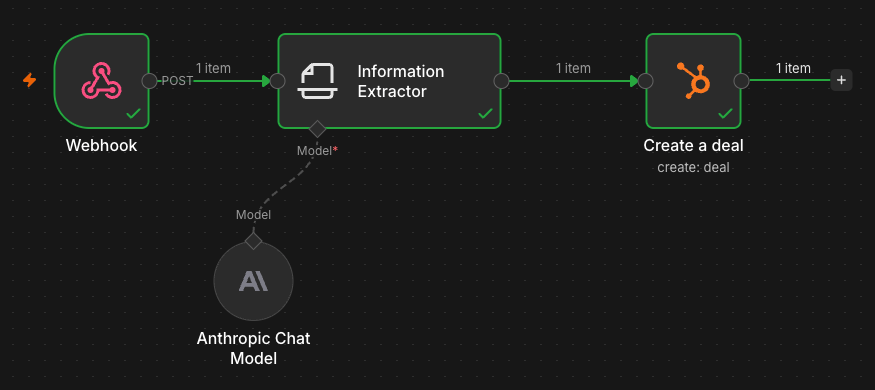
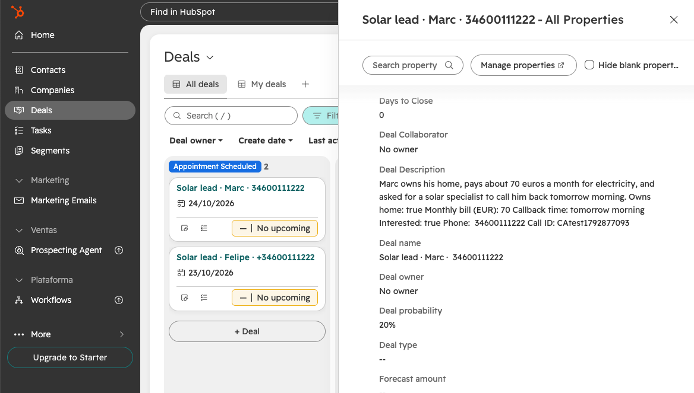
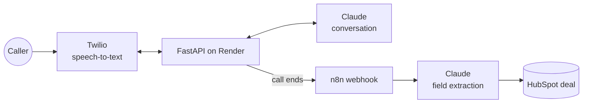

# Voice agent POC

An AI phone agent that answers calls, qualifies solar leads in a natural conversation, and creates a deal in HubSpot through n8n.

**Stack:** Python · FastAPI · Twilio Voice · Claude · n8n · HubSpot · Render

## Demo

*When a call ends, the app posts the transcript to n8n. Claude extracts the lead fields and n8n creates the deal in HubSpot.*

*The resulting deal, with the call summary and the qualification fields.*

## Architecture

## How a call works

1. Twilio posts to `/voice/incoming`. The agent greets the caller and listens.
2. Each answer arrives at `/voice/gather`, and Claude decides what to say next.
3. Once all the info is collected, Claude adds `[END]`. The agent says goodbye and hangs up.
4. In the background, the transcript goes to n8n, which extracts the fields and creates the deal.